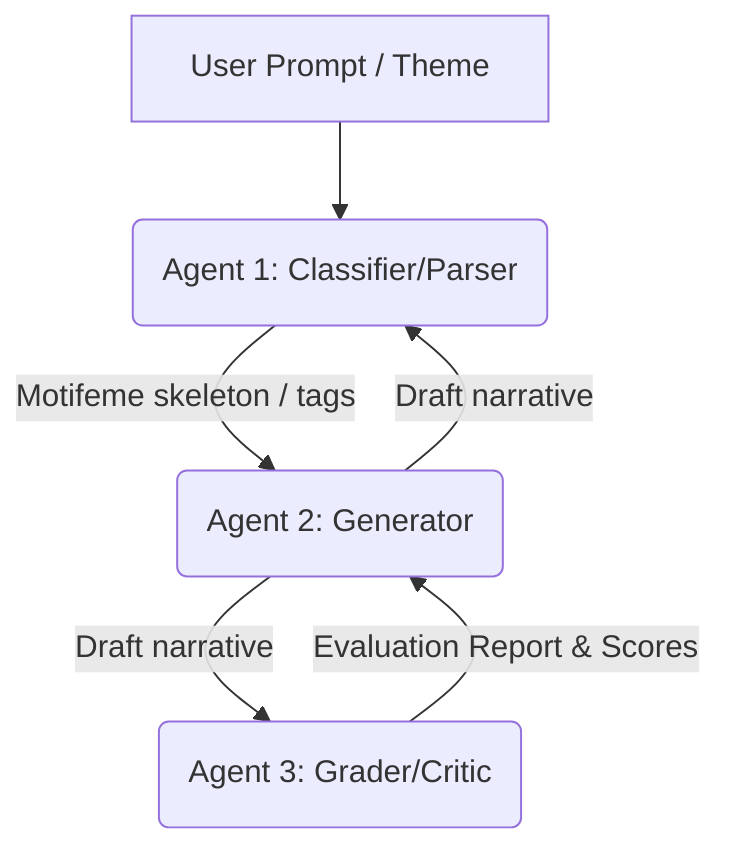

# Research Notes: Ju|'hoansi Narratives and Multi-Agent Story Generation

This document outlines the theoretical background, comparative narrative frameworks, and the specialized multi-agent architecture designed to generate and analyze culturally authentic Ju|'hoansi stories.

---

## 1. Theoretical Frameworks

To bridge the gap between Western formalist analysis and indigenous oral epistemologies, the project incorporates three structural folklore concepts:

### A. Syntagmatic vs. Paradigmatic Structures (Claude Lévi-Strauss)
While linear narrative analysis focuses on the chronological sequence of events (syntagmatic), paradigmatic analysis looks at the underlying conceptual binary oppositions.
* **The Camp vs. The Bush**: In Ju|'hoan narratives, spatial boundaries govern character behavior. The **Camp** represents safety, social order, egalitarian sharing, and human society. The **Bush** represents wild nature, danger, isolation, spirits ($g//awasi$), and supernatural power.
* **Spatial State Tracking**: The system must track character movements between these zones, as entering the Bush changes the rules of permissible narrative events and invites transformation.

### B. The Concept of the Motifeme (Alan Dundes)
Alan Dundes adapted Propp's "functions" into a leaner concept called the **motifeme** to analyze indigenous American narratives, which are structurally shorter and more direct than European quest-tales.
* **Lean Structural Chains**: Instead of a 31-step journey, Ju|'hoan narratives often consist of compact motifeme chains:
  * $\text{Lack} \rightarrow \text{Lack Liquidated}$
  * $\text{Interdiction (Taboo)} \rightarrow \text{Violation} \rightarrow \text{Consequence}$
* **Acceptance of Shorter Forms**: The grader agent should not penalize narratives for being short or omitting late quest functions (like "Ascension to the Throne"), as brevity is culturally standard.

### C. Cultural Oicotypes (Carl von Sydow)
An **oicotype** is a local, geographically or culturally adapted variant of a universal folklore motif.
* **Variable Grounding**: Universal elements must map to Ju|'hoansi ecological and social realities:
  * *Magical Agent* $\rightarrow$ A magical gemsbok horn, a digging stick, a rain-animal, or ancestral blood.
  * *Donor/Helper* $\rightarrow$ An elder relative (grandmother), a trickster figure, or local fauna.
  * *Setting* $\rightarrow$ Red mountains, dry valleys, waterholes, and campfire circles (not castles, roads, or kingdoms).

---

## 2. Vladimir Propp's Morphology vs. Ju|'hoansi Narratives

Vladimir Propp's *Morphology of the Folktale* (1928) serves as our baseline but requires significant modifications due to three primary misalignments:

| Attribute | Propp's Indo-European Baseline | Ju|'hoansi Oral Tradition |
| :--- | :--- | :--- |
| **Sequence** | Strict linear progression ($\alpha \rightarrow \beta \rightarrow \gamma \dots$) | Episodic, symmetrical, recursive, and cyclical loops. |
| **Role Fluidity** | Static characters (Hero, Villain, Donor, Helper) | Porous boundaries (e.g., Trickster is both Villain and Donor). |
| **Resolution** | Individual ascension (Wedding $W^*$, Wealth, Throne) | Social restoration, sharing, and collective re-integration. |
| **Vengeance** | Execution/destruction of the Villain | Restorative justice or integration after being taught a lesson. |

---

## 3. LangGraph Three-Agent Architecture

To automate generation, tagging, and evaluation, we implement a multi-agent feedback loop in LangGraph:

### Agent 1: The Classifier/Parser
* **Role**: Extracts structural functions, motifemes, and spatial transitions from narratives.
* **Extended Taxonomy**: Uses a custom schema that features an **Escape Hatch** for indigenous-specific motifs that Propp lacks:
  * `[Transmutation]` (human-animal zoomorphism)
  * `[Egalitarian Distribution]` (sharing meat/water)
  * `[Ancestral/Nǀum Intervention]` (shamanic healing or grandmother life-giving)
* **Spatial Tracking**: Tags transitions between `The Camp` and `The Bush`.

### Agent 2: The Generator/Storywriter
* **Role**: Generates structurally sound and culturally accurate narratives.
* **Hierarchical Generation Workflow**:
  1. **Step 1 (Outline)**: Generates a structural formula or motifeme skeleton (e.g., $\text{Lack} \rightarrow \text{Deception} \rightarrow \text{Metamorphosis}$).
  2. **Step 2 (Fleshing)**: Populates the skeleton using strictly localized environmental, geographical, and cultural variables (foraging, waterholes, campfires).

### Agent 3: The Critic/Grader
* **Role**: Reviews and scores the generated stories, providing a detailed report to Agent 2.
* **Dual-Scoring Rubric**:
  1. **Syntactic Alignment Score**: Checks if the story maintains a logical, coherent sequence of actions (even if short).
  2. **Cultural Semantic Integrity Score**: Evaluates variable grounding and core values. If the story features cultural violations (e.g., hoarding meat, individualistic greed praised, or lack of sharing), it flags them as a critical failure.
* **Linguistic Verification**: Cross-references terms with `ju_dictionary.xls` and [book.txt](file:///C:/Users/lmy/.gemini/antigravity/brain/05bff78e-6959-403a-86ba-4d441a2faffe/scratch/book.txt).

---

## 4. Linguistic & Storytelling Resources

* **Folktales Database ([ju_folktales.txt](file:///C:/Users/lmy/.gemini/antigravity/brain/05bff78e-6959-403a-86ba-4d441a2faffe/scratch/ju_folktales.txt))**: Contains 14 transcribed stories with interlinear Ju|'hoan-English translations and synopses.
* **Lexicon (`ju_dictionary.xls`)**: Features **4,737 rows** mapping Ju|'hoansi searchable terms to parts of speech and English definitions.
* **Grammar Primer ([book.txt](file:///C:/Users/lmy/.gemini/antigravity/brain/05bff78e-6959-403a-86ba-4d441a2faffe/scratch/book.txt))**: Covers greetings, click phonetics, tenses, pronouns, prepositions, questions, and idiomatic expressions.
