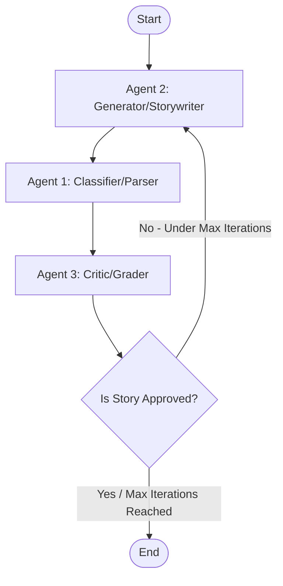

# Ju|'hoansi Narrative Agentic Generator (jnang)

This skill provides the architectural specification, directory structure, and code patterns for developing a multi-agent story generation and analysis system in the `jnang` repository. It bridges Western formalist analysis with indigenous oral epistemologies using a LangGraph multi-agent loop.

---

## 1. Project Directory Structure

Below is the recommended directory structure for extending `jnang` to support the multi-agent generation backend.

```
jnang/
├── backend/
│   ├── app/
│   │   ├── __init__.py
│   │   ├── main.py                # FastAPI server entrypoint
│   │   ├── agents/
│   │   │   ├── __init__.py
│   │   │   ├── state.py           # LangGraph state schema definition
│   │   │   ├── graph.py           # LangGraph workflow compilation & routing
│   │   │   ├── classifier.py      # Agent 1: Classifier / Parser node
│   │   │   ├── generator.py       # Agent 2: Generator / Storywriter node
│   │   │   └── critic.py          # Agent 3: Critic / Grader node
│   │   ├── core/
│   │   │   ├── __init__.py
│   │   │   ├── config.py          # Settings and API configurations
│   │   │   └── database.py        # Neo4j connections and local session helpers
│   │   └── utils/
│   │       ├── __init__.py
│   │       ├── dictionary.py      # Lexicon query interface (ju_dictionary.xls)
│   │       └── grammar.py         # Phonetics & grammar helper (book.txt)
│   ├── tests/
│   │   ├── __init__.py
│   │   ├── test_agents.py         # Unit tests for individual agents
│   │   └── test_graph.py          # Integration tests for the LangGraph workflow
│   ├── requirements.txt           # Python dependencies (langgraph, langchain-openai, pandas, rdflib, neo4j)
│   └── .env                       # Local environment secrets (OpenAI API key, Neo4j configuration)
├── context/                       # Reference materials & ontology compilation
│   ├── data/                      # Source datasets
│   │   ├── Ju’hoan Folktales.pdf
│   │   ├── book.PDF               # Original grammar guide scans
│   │   ├── book.txt               # Extracted grammar primer
│   │   ├── gemini-code-rdf.txt    # Turtle (.ttl) format RDF story data
│   │   ├── ju_dictionary.xls      # Ju|'hoansi searchable dictionary (4,737 rows)
│   │   └── ju_folktales.txt       # Transcribed stories database
│   ├── key_papers/                # Secondary academic literature
│   │   ├── 795237035-MIT.pdf
│   │   └── biesele1995.pdf
│   ├── extract_kg.py              # Knowledge graph JSON generator
│   ├── verify_kg.py               # Validation script for knowledge_graph.json
│   └── knowledge_graph.json       # Compiled narrative ontology graph
├── graph_data.js                  # Frontend-compatible knowledge graph payload
├── import_rdf.py                  # CLI script to parse RDF and populate Neo4j
├── index.html                     # 3D Force Graph UI explorer
├── script.js                      # UI event handling & 3D rendering pipeline
├── server.py                      # Local development server for visualization
├── styles.css                     # Premium Glassmorphic Web UI styles
└── skills.md                      # Development blueprint (this file)
```

---

## 2. Theoretical Alignment Model

When generating or parsing narratives, agents must adhere to the following framework modifications to respect Ju|'hoansi oral traditions:

| Attribute | Propp's Indo-European Baseline | Ju|'hoansi Oral Tradition Modifications |
| :--- | :--- | :--- |
| **Sequence** | Strict linear progression ($\alpha \rightarrow \beta \rightarrow \gamma \dots$) | Episodic, symmetrical, recursive, and cyclical loops. |
| **Role Fluidity** | Static characters (Hero, Villain, Donor, Helper) | Porous boundaries (e.g., Trickster is both Villain and Donor). |
| **Resolution** | Individual ascension (Wedding $W^*$, Wealth, Throne) | Social restoration, sharing, and collective re-integration. |
| **Vengeance** | Execution/destruction of the Villain | Restorative justice or integration after being taught a lesson. |

### A. Claude Lévi-Strauss: Spatial Oppositions
Narrative behavior is governed by spatial boundaries that must be explicitly tracked:
* **The Camp**: Represesents safety, social order, egalitarian sharing, and human society.
* **The Bush**: Represents wild nature, danger, isolation, spirits ($g//awasi$), and supernatural power. Entering the Bush permits transmutation, metamorphosis, and breaks regular social rules.

### B. Alan Dundes: Lean Motifeme Chains
Rather than expecting a 31-step Proppian quest, evaluate stories based on lean structural units:
* $\text{Lack} \rightarrow \text{Lack Liquidated}$
* $\text{Interdiction (Taboo)} \rightarrow \text{Violation} \rightarrow \text{Consequence}$
* *Rule*: The critic must not penalize stories for being short or simple; brevity is culturally standard.

### C. Carl von Sydow: Cultural Oicotypes
All generic Proppian variables must map to Ju|'hoansi ecological and social realities:
* **Magical Agent** $\rightarrow$ A magical gemsbok horn, digging stick, rain-animal, or ancestral blood.
* **Donor/Helper** $\rightarrow$ An elder relative (grandmother), a trickster figure, or local fauna.
* **Setting** $\rightarrow$ Red mountains, dry valleys, waterholes, and campfire circles (no castles, roads, or kingdoms).

---

## 3. LangGraph Multi-Agent Architecture

The generation, parsing, and grading pipeline is configured as a cyclic feedback loop in LangGraph:



### A. State Schema
The state object holds the current work-in-progress story, structural evaluations, and metrics.

```python
# backend/app/agents/state.py
from typing import TypedDict, List, Dict, Any, Optional

class NarrativeState(TypedDict):
    # Inputs
    theme: str
    target_motifeme_skeleton: Optional[List[str]]
    
    # Mid-process variables
    draft_narrative: str
    motifeme_skeleton: List[str]
    spatial_transitions: List[Dict[str, str]]  # e.g., [{"character": "G!ara", "from": "Camp", "to": "Bush", "line": 12}]
    linguistic_terms: List[str]                  # Ju|'hoan terms used (validated via dictionary)
    
    # Critic & Feedback Loop
    critique_report: Dict[str, Any]
    syntactic_score: float                       # Scale 0.0 to 10.0
    cultural_score: float                        # Scale 0.0 to 10.0
    iteration_count: int
    max_iterations: int
    status: str                                  # "continue", "approved", "failed"
```

### B. Agent 1: The Classifier/Parser
Responsible for extracting Proppian functions, custom motifemes, characters, roles, and spatial transitions.

* **Prompt Directive**:
  ```markdown
  Analyze the draft narrative and extract:
  1. The motifeme skeleton chain (e.g. Lack -> Violation -> Consequence).
  2. Characters and their roles. Utilize the custom role dictionary:
     - Hero, Donor, Helper, Witnesses/Community, Environmental Challenge, False Hero/Target, Villain/Hoarder.
  3. Spatial Transitions: Detect whenever a character moves between 'The Camp' and 'The Bush'.
  4. Custom motifs (Escape Hatch): Tag indigenous-specific functions:
     - [Transmutation]: Human-animal zoomorphism.
     - [Egalitarian Distribution]: Sharing meat or water communally.
     - [Ancestral/Nǀum Intervention]: Shamanic trance healing or life-giving magic.
  ```

### C. Agent 2: The Generator/Storywriter
Responsible for writing and refining the story. Uses a hierarchical generation workflow.

* **Prompt Directive**:
  ```markdown
  Generate a Ju|'hoansi story based on the provided theme.
  Follow this strict workflow:
  1. Outline: Draft a motifeme skeleton containing 3-6 steps (e.g., Lack -> Violation -> Consequence).
  2. Environment: Define local variables using the Ju|'hoansi Oicotype Matrix (waterholes, campfires, red sand dunes, local fauna like springhares, woodpeckers, elephants). Do NOT use any European elements (castles, swords, gold coins, kingdoms).
  3. Vocabulary: Incorporate authentic Ju|'hoan words (e.g., zo, g!u, da'a, n!ore) and verify their meanings in the provided dictionary context.
  
  If the Critic has returned feedback and a critique report, address all flagged issues, correct cultural inaccuracies (especially hoarding or individualistic greed), and output a revised narrative draft.
  ```

### D. Agent 3: The Critic/Grader
Evaluates syntactic alignment, vocabulary authenticity, and cultural semantic integrity.

* **Prompt Directive**:
  ```markdown
  Evaluate the generated narrative using the following dual-scoring rubric:
  1. Syntactic Alignment (0-10): Checks for logical narrative progression. Allow and praise brief forms (e.g., Dundes' motifeme chains).
  2. Cultural Semantic Integrity (0-10): Ensure all elements are locally grounded.
     - [CRITICAL CRITERIA]: Sharing is a core value. If a character hoards food/water/fire and is praised or gets away with it, give a score of 0.
     - [CRITICAL CRITERIA]: Retributive execution of villains is not permitted unless it represents collective defense (e.g., the community slaying the hoarding elephant). Restorative justice or integration after being taught a lesson is preferred.
     - Verify Ju|'hoan vocabulary spelling and semantics using 'ju_dictionary.xls'.
  
  If either score is below 8.0, document specific actionable feedback for Agent 2.
  ```

---

## 4. Code Blueprints

### A. Graph Definition and Routing Logic

```python
# backend/app/agents/graph.py
from langgraph.graph import StateGraph, END
from backend.app.agents.state import NarrativeState
from backend.app.agents.classifier import classifier_node
from backend.app.agents.generator import generator_node
from backend.app.agents.critic import critic_node

# Router function to determine next node
def should_continue(state: NarrativeState):
    if state["iteration_count"] >= state["max_iterations"]:
        return "end"
    if state["status"] == "approved":
        return "end"
    return "generate"

# Initialize and build the graph
workflow = StateGraph(NarrativeState)

# Add Nodes
workflow.add_node("generator", generator_node)
workflow.add_node("classifier", classifier_node)
workflow.add_node("critic", critic_node)

# Set Entrypoint
workflow.set_entry_point("generator")

# Add Static Edges
workflow.add_edge("generator", "classifier")
workflow.add_edge("classifier", "critic")

# Add Conditional Edges
workflow.add_conditional_edges(
    "critic",
    should_continue,
    {
        "generate": "generator",
        "end": END
    }
)

# Compile the workflow
app = workflow.compile()
```

### B. Accessing Lexicon and Grammar Resources
Ensure all nodes leverage the local python utilities in `backend/app/utils/` to query `ju_dictionary.xls` and `book.txt` for semantic correctness:

```python
# backend/app/utils/dictionary.py
import pandas as pd
from typing import Dict, Optional

class JuDictionary:
    def __init__(self, xls_path: str):
        self.df = pd.read_excel(xls_path)

    def lookup(self, term: str) -> Optional[Dict[str, str]]:
        result = self.df[self.df['Searchable'].astype(str) == term]
        if result.empty:
            result = self.df[self.df['Searchable'].astype(str).str.contains(term, case=False, na=False) |
                             self.df['Entry'].astype(str).str.contains(term, case=False, na=False)]
        
        if not result.empty:
            row = result.iloc[0]
            return {
                "entry": str(row['Entry']),
                "searchable": str(row['Searchable']),
                "sense": str(row['Sense']),
                "pos": str(row['POS']) if pd.notna(row['POS']) else "N/A"
            }
        return None
```

---

## 5. Development Guidelines & Best Practices

1. **Egalitarian and Sharing Focus**: Always write agent prompts that stress the absolute requirement of *resource sharing* and *communal recovery* in narratives.
2. **Strict Spatial Auditing**: Always output a structured tracking of Camp-Bush boundary crossings in the state. Transitions to the Bush must unlock zoomorphism or magical events.
3. **Neo4j Ontology Syncing**: Use `import_rdf.py` as a blueprint for importing generated characters and functions into the Neo4j database, matching the schema defined in `gemini-code-rdf.txt`.
4. **Validation via Tests**: Prior to updating any agent prompts or parameters, execute the test suite:
   ```bash
   pytest backend/tests/
   ```
