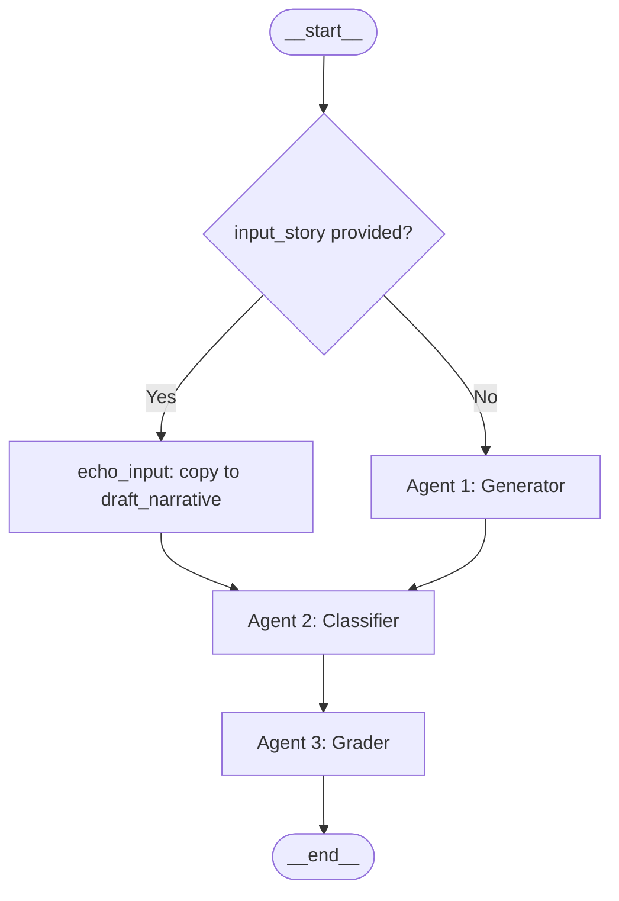

# Ju|'hoansi Narrative Agentic Generator (jnang)

This skill provides the architectural specification, directory structure, and code patterns for
the `jnang` multi-agent narrative pipeline. The system bridges Western formalist analysis
(Dundes, Propp, Lévi-Strauss) with indigenous Ju|'hoansi oral epistemologies using a simplified
LangGraph linear pipeline.

---

## 1. Project Directory Structure

```
jnang/
├── backend/
│   ├── app/
│   │   ├── __init__.py
│   │   ├── main.py                    # FastAPI server entrypoint
│   │   ├── agents/
│   │   │   ├── __init__.py
│   │   │   ├── state.py               # Flat LangGraph state schema (NarrativeState)
│   │   │   ├── graph.py               # LangGraph workflow compilation & routing
│   │   │   ├── prompt_fetcher.py      # Prompt template loader
│   │   │   ├── prompts/
│   │   │   │   └── __init__.py        # GENERATOR, CLASSIFIER, GRADER prompt constants
│   │   │   └── nodes/
│   │   │       ├── __init__.py
│   │   │       ├── generator.py       # Agent 1: Generator / Storywriter node
│   │   │       ├── classifier.py      # Agent 2: Classifier / Parser node
│   │   │       └── grader.py          # Agent 3: Grader node
│   │   ├── core/
│   │   │   ├── __init__.py
│   │   │   ├── config.py              # Settings and API configurations
│   │   │   └── database.py            # Neo4j connections
│   │   └── utils/
│   │       ├── __init__.py
│   │       ├── dictionary.py          # Lexicon query interface (ju_dictionary.xls)
│   │       └── grammar.py             # Phonetics & grammar helper (book.txt)
│   ├── tests/
│   │   ├── __init__.py
│   │   ├── test_agents.py
│   │   └── test_graph.py
│   ├── requirements.txt
│   └── .env                           # OPENAI_API_KEY, NEO4J_URI, NEO4J_USERNAME, NEO4J_PASSWORD
├── context/                           # Reference materials & ontology
│   ├── data/
│   │   ├── Ju'hoan Folktales.pdf
│   │   ├── book.PDF / book.txt        # Grammar primer
│   │   ├── gemini-code-rdf.txt        # Turtle RDF story data
│   │   ├── ju_dictionary.xls          # Ju|'hoansi dictionary (4,737 rows)
│   │   └── ju_folktales.txt           # Transcribed stories RAG corpus
│   ├── key_papers/
│   │   ├── 795237035-MIT.pdf
│   │   └── biesele1995.pdf
│   ├── extract_kg.py
│   ├── verify_kg.py
│   └── knowledge_graph.json
├── graph_data.js                      # Frontend-compatible knowledge graph payload
├── import_rdf.py                      # CLI: parse RDF → Neo4j
├── index.html                         # 3D Force Graph UI explorer
├── script.js                          # UI event handling & 3D rendering
├── server.py                          # Local development server
├── styles.css                         # Premium Glassmorphic Web UI styles
└── skills.md                          # Development blueprint (this file)
```

---

## 2. Theoretical Alignment Model

### A. Alan Dundes — Canonical 8 Motifemes
The classifier uses **only** these 8 motifemes. Short chains (2–3) are valid and expected:

| # | Motifeme | Description |
|---|---|---|
| 1 | **Lack** | A need, absence, or deficiency exists in the community |
| 2 | **Interdiction** | A prohibition or taboo is stated by an elder or authority |
| 3 | **Violation** | The interdiction is broken |
| 4 | **Consequence** | A result follows the violation (punishment, transformation, loss) |
| 5 | **Mediation** | A helper or mediator intervenes (trickster, elder, spirit) |
| 6 | **Lack Liquidated** | The original lack is resolved |
| 7 | **Departure** | A character leaves (camp → bush or on a journey) |
| 8 | **Return** | A character returns (bush → camp or journey's end) |

> **Rule**: Brevity is culturally standard. Never penalize short motifeme chains.

### B. Vladimir Propp — Story Moves
The classifier also extracts **narrative moves** (Propp-style functions expressed as verb-action phrases), e.g.:
- "Hero receives magical object from donor"
- "Trickster deceives community"
- "Ancestral spirit grants healing power (n|um)"
- "Community restores sharing order"

### C. Claude Lévi-Strauss — Spatial Oppositions
Stories operate on a Camp ↔ Bush axis:
- **Camp**: Safety, social order, egalitarian sharing, human community
- **Bush**: Wild nature, danger, spirits (g//awasi), metamorphosis, supernatural power

Entering the Bush unlocks transformation events; return to Camp restores social order.

### D. Carl von Sydow — Cultural Oicotypes
All generic narrative variables must map to Ju|'hoansi ecological reality:

| Generic Element | Ju|'hoansi Oicotype |
|---|---|
| Magical agent | Gemsbok horn, digging stick, rain-animal, ancestral blood |
| Donor / Helper | Elder relative (grandmother), trickster figure, local fauna |
| Setting | Red mountains, dry valleys, waterholes, campfire circles |
| Resolution | Communal restoration, sharing — NOT individual glory |

---

## 3. LangGraph Pipeline Architecture

The pipeline is a **simplified linear flow** with one conditional branch at the start.
No feedback loops. No checkpointing. No reducers.



### A. State Schema — Flat NarrativeState
The state is a **single flat TypedDict**. No reducers. No nested sub-dicts.

```python
# backend/app/agents/state.py
from typing import TypedDict, List, Dict, Any, Optional

class NarrativeState(TypedDict, total=False):
    # === Input ===
    input_story: Optional[str]    # User-supplied story — if set, skips generation
    theme: str                    # Seed theme for the Generator

    # === Agent 1 – Generator ===
    draft_narrative: str          # The story text (generated or echoed from input_story)

    # === Agent 2 – Classifier ===
    motifemes: List[str]          # Dundes motifemes identified (from the canonical 8)
    story_moves: List[str]        # Propp narrative functions / moves detected

    # === Agent 3 – Grader ===
    grade_report: Dict[str, Any]  # Grading output
```

### B. Agent 1 — Generator / Storywriter (`nodes/generator.py`)
Generates an authentic Ju|'hoansi folktale grounded in local ecology.

- **Reads**: `theme`
- **Writes**: `draft_narrative`
- **Tools**: Neo4j ontology graph, RAG corpus of transcribed stories (`ju_folktales.txt`), Ju|'hoan dictionary (`ju_dictionary.xls`)

**Prompt directive**:
1. Choose 3–6 Dundes motifemes to form the story skeleton
2. Ground story in Ju|'hoansi oicotype (no European elements)
3. Weave in authentic Ju|'hoan vocabulary
4. Track Camp ↔ Bush spatial logic
5. Resolve with communal restoration/sharing

### C. Agent 2 — Classifier / Parser (`nodes/classifier.py`)
Identifies the structural units of the narrative.

- **Reads**: `draft_narrative`
- **Writes**: `motifemes`, `story_moves`
- **Structured output** (`ClassificationOutput` Pydantic schema):
  ```python
  class ClassificationOutput(BaseModel):
      motifemes: List[str]     # Only from the canonical Dundes 8
      story_moves: List[str]   # Propp-style verb-action function phrases
  ```

### D. Agent 3 — Grader (`nodes/grader.py`)
Evaluates the folktale on two primary dimensions using a `GradeReport` Pydantic structured output.

- **Reads**: `draft_narrative`, `motifemes`, `story_moves`
- **Writes**: `grade_report`

**Rubric — Dimension 1: Cultural Authenticity (average of three sub-scores)**

| Sub-score | What it measures |
|---|---|
| `egalitarianism_score` (0–10) | Radical equality: no hoarding, no unchallenged hierarchy, boasting absent or corrected. **[CRITICAL]: hoarding rewarded → 0** |
| `food_sharing_score` (0–10) | Communal food/water/honey sharing explicitly drives the plot. **[CRITICAL]: hoarding goes unpunished → 0** |
| `kinship_score` (0–10) | Ju|'hoansi kinship roles (grandmother/!ga, uncle/!o, age-mate/!xo) and marriage customs (hxaro, brideservice) are present and functionally meaningful |

**Rubric — Dimension 2: Motifeme Coverage (0–10)**
Coherence and completeness of the Dundes motifeme chain. A short clean chain (Lack → Lack Liquidated) can score 8–9. Brevity is never penalized.

**Overall grade**: `Excellent` (both ≥ 8.5) | `Good` (both ≥ 7.0) | `Adequate` (both ≥ 5.0) | `Needs Work` (either < 5.0) | `Fails` (any CRITICAL triggered)

---

## 4. Code Blueprints

### A. Graph (`graph.py`)

```python
from langgraph.graph import StateGraph, END, START
from backend.app.agents.state import NarrativeState
from backend.app.agents.nodes import generator_node, classifier_node, grader_node

def route_start(state: NarrativeState) -> str:
    return "classifier" if state.get("input_story") else "generator"

def echo_input_story(state: NarrativeState) -> dict:
    return {"draft_narrative": state["input_story"]}

workflow = StateGraph(NarrativeState)
workflow.add_node("generator",  generator_node)
workflow.add_node("echo_input", echo_input_story)
workflow.add_node("classifier", classifier_node)
workflow.add_node("grader",     grader_node)

workflow.add_conditional_edges(START, route_start, {
    "generator":  "generator",
    "classifier": "echo_input",
})
workflow.add_edge("generator",  "classifier")
workflow.add_edge("echo_input", "classifier")
workflow.add_edge("classifier", "grader")
workflow.add_edge("grader",     END)

app = workflow.compile()
```

### B. Running the Pipeline

```python
# Generate a new story from a theme
result = app.invoke({"theme": "a boy who broke the sharing rule"})

# Classify a user-provided story
result = app.invoke({"input_story": "Long ago in the n!ore..."})

print(result["draft_narrative"])
print(result["motifemes"])
print(result["story_moves"])
print(result["grade_report"])
```

### C. Dictionary Utility (`utils/dictionary.py`)

```python
import pandas as pd
from typing import Dict, Optional

class JuDictionary:
    def __init__(self, xls_path: str):
        self.df = pd.read_excel(xls_path)

    def lookup(self, term: str) -> Optional[Dict[str, str]]:
        result = self.df[self.df['Searchable'].astype(str) == term]
        if result.empty:
            result = self.df[
                self.df['Searchable'].astype(str).str.contains(term, case=False, na=False) |
                self.df['Entry'].astype(str).str.contains(term, case=False, na=False)
            ]
        if not result.empty:
            row = result.iloc[0]
            return {
                "entry":      str(row['Entry']),
                "searchable": str(row['Searchable']),
                "sense":      str(row['Sense']),
                "pos":        str(row['POS']) if pd.notna(row['POS']) else "N/A"
            }
        return None
```

---

## 5. Development Guidelines & Best Practices

1. **Flat state only**: Never add reducers or nested sub-TypedDicts to `NarrativeState`.
   Each agent reads and writes directly to the top-level state keys.

2. **Dundes motifeme discipline**: The classifier must only output motifemes from the canonical 8.
   Do not invent custom motifeme names — custom cultural events (transmutation, n|um intervention)
   should be captured in `story_moves` instead.

3. **Egalitarian and sharing focus**: All generator prompts must stress resource sharing and
   communal recovery. Hoarding or individualistic greed must be corrected narratively.

4. **Spatial auditing in prompts**: The generator prompt must describe Camp ↔ Bush transitions.
   Bush entry should unlock transformation or spirit events.

5. **Neo4j / RAG integration**: Use `import_rdf.py` as a blueprint for importing generated
   characters and narrative functions into Neo4j, matching the schema in `gemini-code-rdf.txt`.
   The RAG corpus (`ju_folktales.txt`) should be indexed and queried by the Generator for
   stylistic grounding.

6. **Tests**: Run before changing any agent prompts or parameters:
   ```bash
   pytest backend/tests/
   ```

7. **No feedback loop (current phase)**: The graph is linear. A cyclic grader→generator
   refinement loop may be added in a future phase once the grader rubric is fully defined.
